# ThinkReview MCP

Hosted [Model Context Protocol](https://modelcontextprotocol.io) server for **AI code reviews** on pull request and merge request URLs.

Connect **Cursor**, **Claude Code**, **Claude Desktop**, or **GitHub Copilot**, paste a PR/MR URL, and get a structured review — without pasting a diff into chat.

| | |
|---|---|
| **Endpoint** | `https://mcp.thinkreview.dev/v1` |
| **Transport** | Streamable HTTP |
| **Auth** | **OAuth (recommended)** or Bearer token |
| **Registry** | [`io.github.Thinkode/thinkreview`](https://registry.modelcontextprotocol.io/v0.1/servers/io.github.Thinkode%2Fthinkreview/versions/latest) |
| **Product** | [thinkreview.dev/features/mcp](https://thinkreview.dev/features/mcp) |
| **Docs** | [thinkreview.dev/docs/mcp-integration](https://thinkreview.dev/docs/mcp-integration/) |
| **Setup** | [portal.thinkreview.dev/mcp](https://portal.thinkreview.dev/mcp) |

> This repository is for **visibility and client documentation**. ThinkReview MCP runs as a **remote hosted server**. The review engine, auth, billing, and git integrations stay on ThinkReview infrastructure and are not published here.

---

## What it does

ThinkReview MCP exposes one tool:

### `review_url_code`

Run a live code review on a GitHub, GitLab, Azure DevOps, or Bitbucket PR/MR URL.

ThinkReview fetches changed files through your **stored git credentials** (portal Integrations) and returns a structured review: summary, suggestions, security notes, best practices, and suggested follow-up questions.

| Parameter | Required | Description |
|---|---|---|
| `prUrl` | Yes | Full or domain-style PR/MR URL (e.g. `https://github.com/org/repo/pull/42`). This URL is the only identifier ThinkReview needs. |
| `language` | No | Response language (default: English) |
| `forceRegenerate` | No | `true` to bypass cache and force a new review |

URL reviews use the **same review credits** as the ThinkReview browser extension.

---

## Authentication

Choose one method. Interactive configs for both are on [portal.thinkreview.dev/mcp](https://portal.thinkreview.dev/mcp).

| Method | How it works | Best for |
|---|---|---|
| **OAuth (recommended)** | URL-only MCP config → **Authenticate** in the browser on the ThinkReview portal | Cursor, Claude Code, Claude Desktop, Copilot |
| **Bearer token** | Long-lived portal token in `Authorization: Bearer <token>` headers | Extension, CI, or clients that cannot complete OAuth |

OAuth sessions are **separate** from the extension Bearer token. Regenerating the Bearer token does **not** revoke OAuth MCP sessions.

---

## Prerequisites

1. A [ThinkReview](https://thinkreview.dev) account with an active plan or available review credits
2. Git credentials under **Settings → Integrations** for the host of the PR you want to review
3. An MCP client that supports **Streamable HTTP**, plus either:
   - **OAuth** for remote HTTP servers, or
   - A Bearer token from [portal.thinkreview.dev/mcp](https://portal.thinkreview.dev/mcp)

---

## Quick start — OAuth (recommended)

Add a **URL-only** config, then **Authenticate** in your client (browser opens the ThinkReview portal).

### Cursor

```json
{
  "mcpServers": {
    "thinkreview": {
      "url": "https://mcp.thinkreview.dev/v1"
    }
  }
}
```

Enable **thinkreview**, click **Authenticate**, complete portal consent.  
Example: [`examples/oauth/cursor.mcp.json`](examples/oauth/cursor.mcp.json)

### Claude Code

CLI:

```bash
claude mcp add --transport http thinkreview https://mcp.thinkreview.dev/v1
```

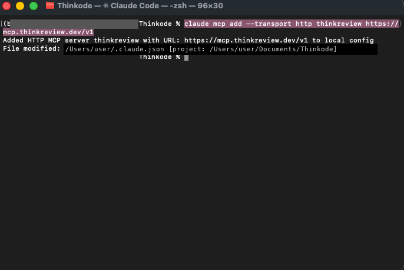

Or config (`~/.claude.json` / project `.mcp.json`):

```json
{
  "mcpServers": {
    "thinkreview": {
      "type": "http",
      "url": "https://mcp.thinkreview.dev/v1"
    }
  }
}
```

Example: [`examples/oauth/claude.mcp.json`](examples/oauth/claude.mcp.json)

#### Authenticate (OAuth)

1. Start Claude Code and run `/mcp`.

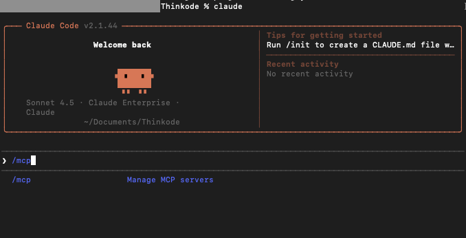

2. Select **thinkreview** — status shows **needs authentication**.

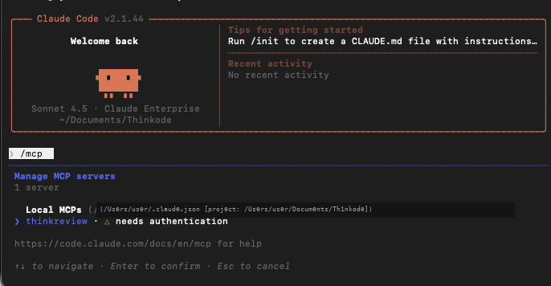

3. Choose **Authenticate**.

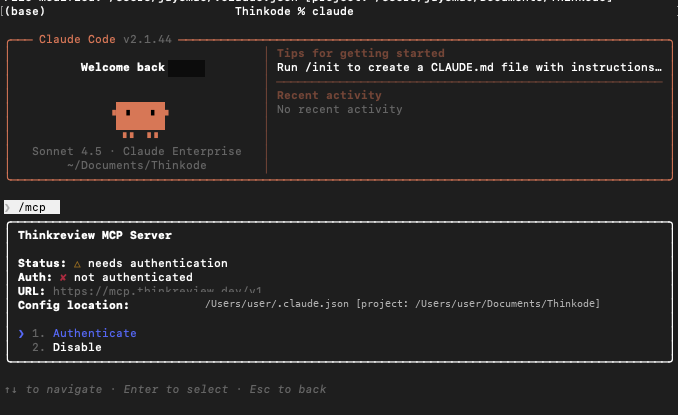

4. Claude Code opens the browser OAuth flow (`/authorize` → portal consent).

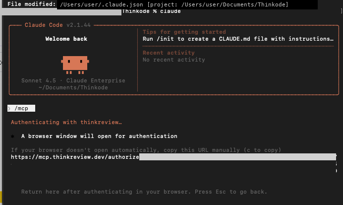

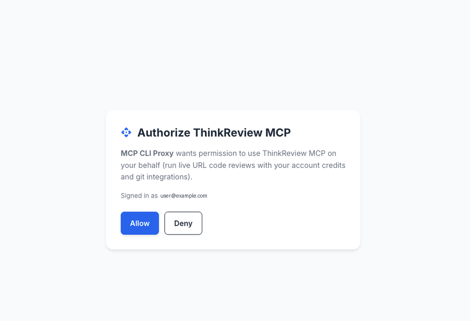

5. After you click **Allow**, return to Claude Code — you should see **Authentication successful**.

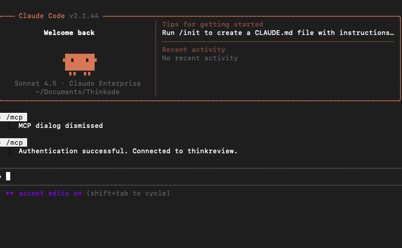

#### Run a review

Ask Claude Code to review a PR URL (tool: `review_url_code`):

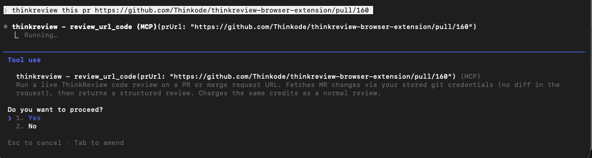

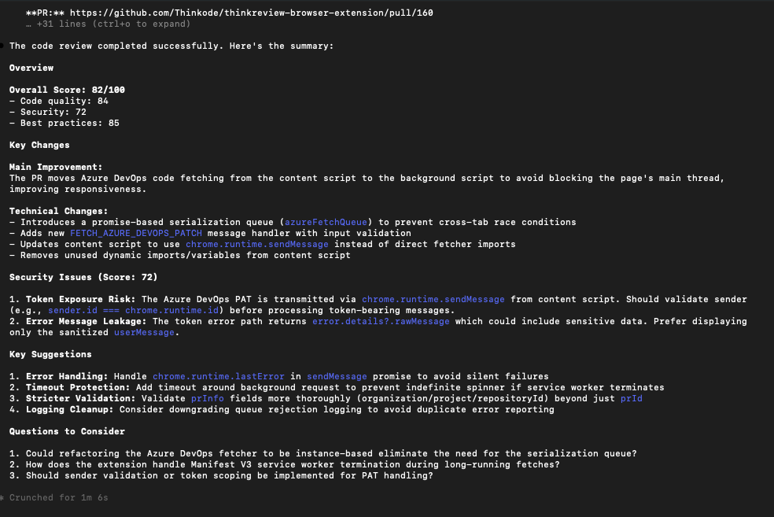

### Claude Desktop

**Preferred:** Settings → **Connectors** → Add custom connector → `https://mcp.thinkreview.dev/v1` → Connect → complete portal OAuth.

Claude Desktop’s `claude_desktop_config.json` does **not** accept Claude Code’s `"type": "http"` block. To use the config file instead, bridge with `mcp-remote` (requires Node.js), then fully quit and reopen Desktop:

```json
{
  "mcpServers": {
    "thinkreview": {
      "command": "npx",
      "args": ["-y", "mcp-remote", "https://mcp.thinkreview.dev/v1"]
    }
  }
}
```

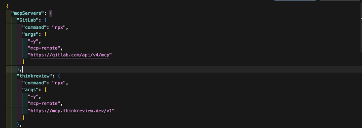

After restart, Settings → Developer → Local MCP servers should show **thinkreview** as **running**. Complete OAuth when prompted (same portal consent as Claude Code).

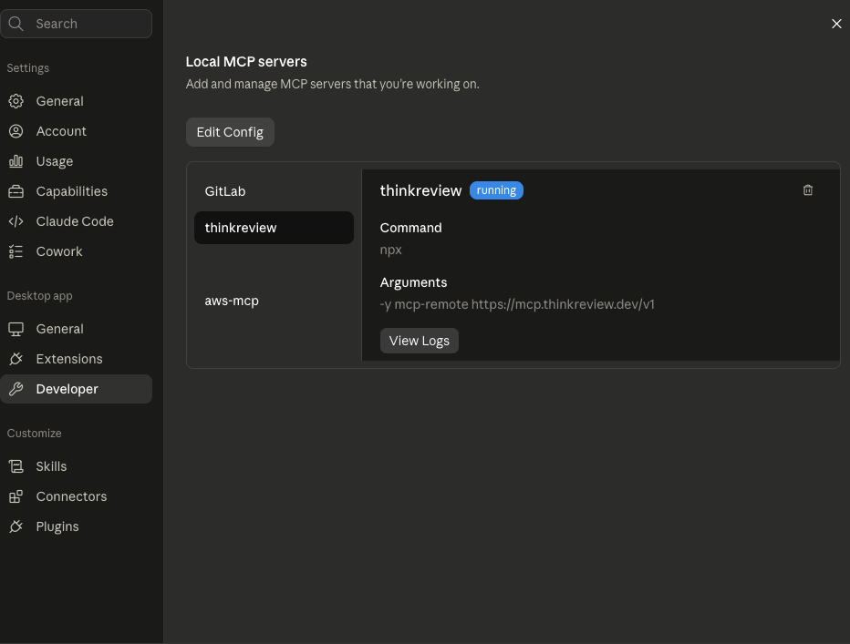

Example: [`examples/oauth/claude-desktop.mcp.json`](examples/oauth/claude-desktop.mcp.json)

### GitHub Copilot (VS Code)

`.vscode/mcp.json` or user MCP config (`servers` key):

```json
{
  "servers": {
    "thinkreview": {
      "type": "http",
      "url": "https://mcp.thinkreview.dev/v1"
    }
  }
}
```

Use **Auth / Authenticate** on the thinkreview server, then enable it in Copilot Chat.  
Example: [`examples/oauth/vscode-copilot.mcp.json`](examples/oauth/vscode-copilot.mcp.json)

### Example prompt

> Call `review_url_code` for https://github.com/org/repo/pull/123

---

## Alternative — Bearer token

Copy your token from [portal.thinkreview.dev/mcp](https://portal.thinkreview.dev/mcp) and add it as a header. Same session token as the browser extension. Regenerating invalidates the previous token for extension and Bearer-based MCP clients.

### Cursor

```json
{
  "mcpServers": {
    "thinkreview": {
      "url": "https://mcp.thinkreview.dev/v1",
      "headers": {
        "Authorization": "Bearer <your-token>"
      }
    }
  }
}
```

Example: [`examples/bearer/cursor.mcp.json`](examples/bearer/cursor.mcp.json)

### Claude Code

```bash
claude mcp add --transport http thinkreview https://mcp.thinkreview.dev/v1 \
  --header "Authorization: Bearer <your-token>"
```

```json
{
  "mcpServers": {
    "thinkreview": {
      "type": "http",
      "url": "https://mcp.thinkreview.dev/v1",
      "headers": {
        "Authorization": "Bearer <your-token>"
      }
    }
  }
}
```

Example: [`examples/bearer/claude.mcp.json`](examples/bearer/claude.mcp.json)

### Claude Desktop (`mcp-remote` + header)

```json
{
  "mcpServers": {
    "thinkreview": {
      "command": "npx",
      "args": [
        "-y",
        "mcp-remote",
        "https://mcp.thinkreview.dev/v1",
        "--header",
        "Authorization:${AUTH_HEADER}"
      ],
      "env": {
        "AUTH_HEADER": "Bearer <your-token>"
      }
    }
  }
}
```

Example: [`examples/bearer/claude-desktop.mcp.json`](examples/bearer/claude-desktop.mcp.json)

### GitHub Copilot (VS Code)

```json
{
  "servers": {
    "thinkreview": {
      "type": "http",
      "url": "https://mcp.thinkreview.dev/v1",
      "headers": {
        "Authorization": "Bearer <your-token>"
      }
    }
  }
}
```

Example: [`examples/bearer/vscode-copilot.mcp.json`](examples/bearer/vscode-copilot.mcp.json)

---

## Supported platforms

Same hosts as the ThinkReview extension:

- GitHub.com and GitHub Enterprise Server
- GitLab.com and self-managed GitLab
- Azure DevOps Cloud and on-premise
- Bitbucket Cloud and Bitbucket Data Center

---

## Security

- Prefer **OAuth** so long-lived tokens are not stored in MCP config files
- If you use a Bearer token, treat it like a password — do not commit it to git
- Store tokens only in local MCP client config or a secrets manager
- Regenerate the Bearer token from the portal if it is ever exposed
- Use git PATs with the minimum scopes needed to read PRs/MRs and diffs

---

## Related

- [Browser extension (open source)](https://github.com/Thinkode/thinkreview-browser-extension)
- [MCP product page](https://thinkreview.dev/features/mcp)
- [Full integration docs](https://thinkreview.dev/docs/mcp-integration/)
- [Support / contact](https://thinkreview.dev/contact)
- [Feedback](https://thinkreview.dev/feedback)

---

## License

Documentation and example configs in this repository are licensed under the [MIT License](LICENSE).

The ThinkReview hosted MCP service, APIs, and review infrastructure remain proprietary to Thinkode / ThinkReview.
